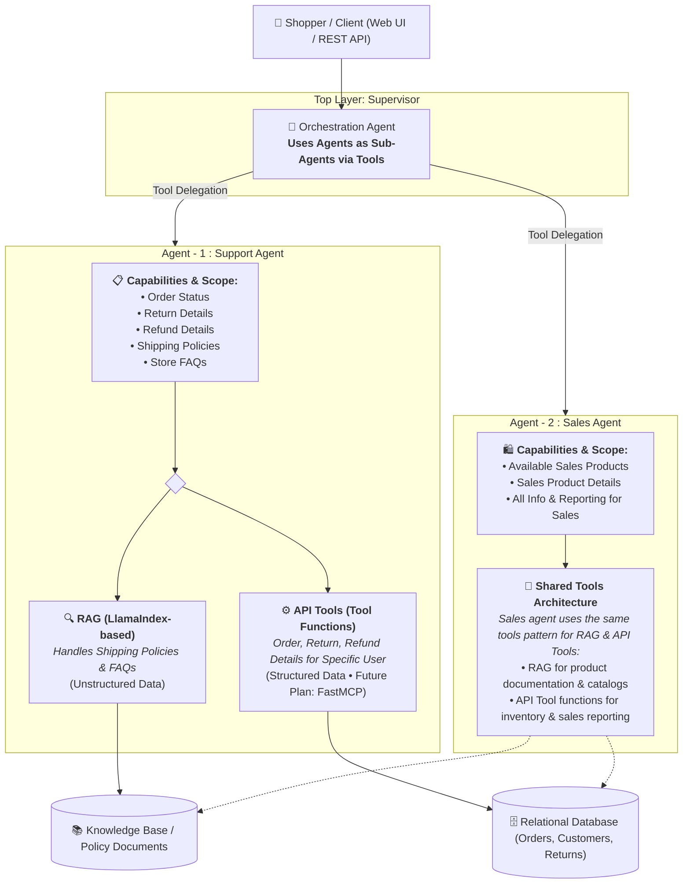

<div align="center">

# 🛒 RetailPilot

**Enterprise-Grade Multi-Agent AI Copilot for E-Commerce Storefronts**

[](LICENSE)
[](https://www.python.org/)
[](https://github.com/langchain-ai/langgraph)
[](https://github.com/langchain-ai/langchain)
[](https://fastapi.tiangolo.com/)
[](https://qdrant.tech/)

*A production-ready, dual-specialist AI copilot built for Indian e-commerce retail (electronics, fashion, home, fitness) with JWT-authenticated customer support, safe SQL sales reporting, and hybrid RAG.*

---

</div>

## 📖 Overview

Online retailers face a dual dilemma: customer support teams are overwhelmed with repetitive order/refund queries, while shoppers abandon product discovery due to fragmented search and inventory lookup.

**RetailPilot** is an open-source, forward-deployed multi-agent copilot designed for **Northstar Commerce Pvt Ltd**, an Indian e-commerce retailer. It provides an audited, unified interface that:
- Intelligently routes shopper inquiries between **Customer Support** and **Sales Discovery** specialists.
- Grounds customer service answers in verified store policy documents via **Hybrid RAG** (Dense semantic vectors + BM25 sparse lexical search).
- Safely queries live transactional tables (orders, inventory, shipments, revenue) using **parameterized, read-only SQL guardrails**.
- Delivers an interactive **Google ADK-style web chat UI** with live tool execution cards, JWT authentication, sortable interactive data tables, and dynamic in-memory API key configuration.

---

## 🏛️ System Architecture

RetailPilot uses a hierarchical multi-agent architecture where a central **Orchestration Agent** treats specialized sub-agents as tools. Both specialist agents leverage a shared, modular tool pattern combining **LlamaIndex RAG** (for unstructured knowledge) and **API Tool Functions** (for structured transactional data & future FastMCP integration).



### Architectural Breakdown

| Component | Role & Scope | Tools & Execution Layer |
| :--- | :--- | :--- |
| **Orchestration Agent** | **Master Supervisor**: Receives incoming user intent, maintains conversational state, and delegates tasks to sub-agents as tools. | LangGraph supervisor agent executing sub-agents (`sales_agent_tool`, `support_agent_tool`) via tool calling. |
| **Agent - 1: Support Agent** | **Customer Support Specialist**: Resolves order tracking, returns, refunds, customer profile inquiries, and store policy questions. | **1. RAG (LlamaIndex-based)**: Ingests unstructured policy markdown & FAQs.<br/>**2. API Tools (Tool functions)**: Queries customer orders, shipments, returns from SQLite database with customer boundary constraints. *(Future Roadmap: FastMCP server)*. |
| **Agent - 2: Sales Agent** | **Sales & Catalog Specialist**: Handles product discovery, inventory availability across regional warehouses, and sales analytics. | **Unified Tool Foundation**: Reuses the same RAG & API Tool patterns used in the support agent for catalog discovery and allowlisted read-only SQL execution. |

---

## ✨ Key Features

### 1. 🧠 Orchestration Agent (LangGraph Supervisor)
- **Sub-Agent Invocation as Tools**: Operates as a master supervisor that binds sub-agents (`support_agent_tool`, `sales_agent_tool`) as dynamic tools.
- **Autonomous Intent Routing**: Routes queries to the appropriate specialist agent based on query intent, while handling greetings directly without tool invocations.
- **State Checkpointing**: In-memory session checkpointing tracks multi-turn dialogues across unique thread IDs.

### 2. 🛡️ Agent - 1: Support Agent
- **Core Scope**: Handles order status, return details, refund details, shipping policies, and store FAQs.
- **RAG (LlamaIndex-based)**: Dedicated to answering questions from unstructured data such as store shipping policies, return SLAs, and FAQs with zero policy hallucinations.
- **API Tools (Tool Functions)**: Executes targeted queries for specific user order, return, and refund records with customer boundary isolation.
- **Future Direction**: FastMCP tool integration roadmap for distributed tool discovery and invocation.

### 3. 📈 Agent - 2: Sales Agent
- **Core Scope**: Handles product discovery, available sales products, sales product details, and all commercial sales info.
- **Shared Tools Architecture**: Reuses the same proven tool architecture as the Support Agent:
  - **RAG**: Explores unstructured product catalogs and specifications.
  - **API Tools**: Safely queries inventory availability across regional warehouses and executes allowlisted read-only analytical SQL queries.

### 4. 🔍 Hybrid Vector Search (Qdrant + BM25)
- **Dual Retrieval Pipeline**: Combines dense semantic embeddings (`GoogleGenAIEmbedding` or local `BAAI/bge-small-en-v1.5`) with sparse lexical BM25 (`fastembed_sparse_model="Qdrant/bm25"`).
- **Asynchronous Execution**: In-memory Qdrant client (`:memory:`) provides sub-millisecond retrieval with document metadata.

### 5. 🔑 Flexible In-Memory API Key System (`tmp not permanent`)
- **Single-Provider Requirement**: Run the entire system with **only Groq OR only Gemini**—no need for multiple keys.
- **Temporary RAM Storage**: Set your key directly in the Web UI or terminal; stored solely in `os.environ` for the running session and **never written to disk or `.env`**.
- **Interactive Terminal Fallback**: If launched without keys, prompts securely in terminal with hidden password input.

### 6. 🎨 Google ADK-Style Web Chat UI
- **PyDataUI + HTMX**: Ultra-fast responsive interface featuring real-time thinking/loading animations.
- **Live Tool Execution Cards**: Visual cards display tool names, arguments, and return statuses during execution.
- **Sortable DataTables**: Markdown tables returned by agents are automatically parsed into interactive, sortable UI tables.
- **In-Chat Key Drawer**: Change or clear API keys on the fly from the top navigation bar without restarting.

### 7. 🚀 Production FastAPI & LangServe Backend
- **LangServe LCEL Chain**: Standardized `/agent/invoke` REST endpoints for third-party integrations.
- **FastMCP Integration**: Universal tool discovery and execution over Model Context Protocol (MCP).
- **SSE Token Streaming**: Server-Sent Events endpoint (`/stream_example`) for real-time streaming output.

---

## 📁 Repository Structure

```text
RetailPilot/
├── agent/                         # Multi-Agent Core
│   ├── graph.py                   # LangGraph StateGraph & supervisor router
│   ├── llm_models.py              # Dynamic LLM provider (Groq / Gemini) & in-memory key manager
│   ├── chat_app.py                # Agent invocation & streaming wrappers
│   ├── salesAgent/                # Sales specialist agent
│   │   ├── agent.py               # Agent definition & tool binding
│   │   └── prompt.py              # Sales system prompts & guardrails
│   ├── supportAgent/              # Support specialist agent
│   │   ├── agent.py               # Support agent definition
│   │   ├── prompt.py              # Support system prompts & customer constraints
│   │   └── tools.py               # Database connections & schema inspection
│   └── RAG/                       # Hybrid RAG Pipeline
│       ├── rag.py                 # LlamaIndex Qdrant hybrid index
│       ├── utils.py               # Embedding & LLM configuration
│       └── tool.py                # LangChain RAG retrieval tool
├── data/                          # Data Layer & Synthetic Store
│   ├── customers.db               # SQLite database with sample customers & purchases
│   ├── retailpilot_case/          # Complete retail case study
│   │   ├── retailpilot.db         # Full relational SQLite database
│   │   ├── knowledge/             # Curated store policy markdown documents
│   │   └── evals/                 # Golden evaluation prompts
├── models/                        # Pydantic & Database State Models
│   └── db_model.py                # MessageState & agent payload definitions
├── prompts/                       # Master prompts
│   └── prompt.py                  # LangGraph supervisor instructions
├── utils/                         # Helper Tools & Guardrails
│   └── tools.py                   # sales_agent_tool, support_agent_tool, get_details, invoice_generator
├── tests/                         # Test Suite
│   └── test_app.py                # HTTP endpoints & FastMCP test suite
├── app.py                         # FastAPI + LangServe + UnifiedNexus application
├── chat_ui.py                     # Google ADK-style web chat app with JWT authentication
├── requirements.txt               # Python package dependencies
├── LICENSE                        # Apache 2.0 License
└── README.md                      # Project documentation
```

---

## ⚡ Quick Start

### 1. Prerequisites
- **Python 3.11 or 3.12**
- Git

### 2. Clone the Repository
```bash
git clone https://github.com/your-username/RetailPilot.git
cd RetailPilot
```

### 3. Create a Virtual Environment
```bash
# Using Conda
conda create -n retailpilot python=3.12 -y
conda activate retailpilot

# OR using venv
python3 -m venv .venv
source .venv/bin/activate  # On Windows: .venv\Scripts\activate
```

### 4. Install Dependencies
```bash
pip install -r requirements.txt
```

---

## 🔑 API Key Setup (Choose Any Option)

RetailPilot is built to be flexible: **you only need ONE API key** (either Groq or Gemini).

> [!NOTE]
> All API keys can be supplied temporarily in RAM (`tmp not permanent`). They are never saved to `.env` or written to disk.

#### Option A: Enter via Web UI (Recommended)
You do not need to set any environment variables before starting. Simply launch the web UI, and enter your Groq (`gsk_...`) or Gemini (`AIza...`) key directly in the **Temporary API Key** field on the login screen or via the **🔑 Set API Key** header drawer.

#### Option B: Temporary Shell Session Export
Set the key temporarily in your current terminal session:
```bash
# For Groq:
export GROQ_API_KEY="gsk_your_groq_api_key_here"

# OR for Gemini:
export GOOGLE_API_KEY="AIzaSy_your_gemini_api_key_here"
```
*(This variable lives only in the current terminal tab's memory and is discarded when the terminal is closed).*

#### Option C: Optional `.env` File
If you prefer persistent local development, create a `.env` file:
```env
# Choose Groq:
GROQ_API_KEY="gsk_..."

# OR Gemini:
GOOGLE_API_KEY="AIzaSy..."

# JWT secret for customer authentication:
JWT_SECRET="RetailPilotSecret"
```

---

## 🚀 Running the Application

### 1. Web Chat UI (Recommended)
Launch the Google ADK-style interactive customer portal:
```bash
python chat_ui.py
```
Open your browser at **`http://localhost:8080`**.

#### 👤 Demo Login Credentials
The synthetic database comes pre-configured with demo customer accounts. Click the quick-fill buttons or enter:

| Customer Name | Email Address | Numeric Password | Account Tier |
| :--- | :--- | :--- | :--- |
| **Kiran Iyer** | `customer0001@example.test` | `60115` | Premium Customer |
| **Sara Sharma** | `customer0002@example.test` | `41040` | Standard Customer |

---

### 2. FastAPI & LangServe REST API
Launch the REST API server:
```bash
python app.py
```
- **API Server**: `http://127.0.0.1:8000`
- **Swagger Docs**: `http://127.0.0.1:8000/docs`
- **LangServe Endpoint**: `http://127.0.0.1:8000/agent/invoke`
- **FastMCP SSE Mount**: `http://127.0.0.1:8000/mcp`

#### Example REST Request (LangServe):
```bash
curl -X POST "http://127.0.0.1:8000/agent/invoke" \
     -H "Content-Type: application/json" \
     -d '{
       "input": {
         "query": "Check my recent order details",
         "thread_id": "session_user_01"
       }
     }'
```

---

## 🧪 Testing

Run the automated test suite to verify HTTP endpoints, FastMCP tools, and chain invocations:
```bash
python tests/test_app.py
```

Expected output:
```text
--- 1. Testing HTTP REST Endpoints ---
✅ GET /: RetailPilot Agent Service
✅ GET /health: {'status': 'healthy'}
✅ POST /calculate (REST): {'result': 42.0, ...}
✅ POST /agent/invoke (LangServe): ...

--- 2. Testing FastMCP Tools (AI Agent Layer) ---
✅ Discovered MCP Tools: ['calculate', 'agent_chain_runner', 'get_system_metrics']
✅ MCP Tool 'calculate' Result: {'result': 100.0}
✅ MCP Tool 'agent_chain_runner': ...
✅ MCP Tool 'get_system_metrics': {'status': 'optimal'}

🎉 ALL TESTS PASSED SUCCESSFULLY!
```

---

## 💬 Sample Prompts to Try in the UI

### 📦 Customer Support Scenarios:
- *"What is the status and delivery date of my recent purchase?"*
- *"Can you please generate and display my purchase invoice?"*
- *"What is your return policy for open-box electronics?"*
- *"I received a damaged item. How many days do I have to initiate a refund?"*

### 🛍️ Sales & Discovery Scenarios:
- *"Show me top-rated noise-cancelling headphones available under ₹15,000."*
- *"Which regional warehouse currently has stock for running shoes?"*
- *"Compare the technical specifications between the top two smartwatches in inventory."*
- *"What are the most popular home & kitchen products sold this month?"*

---

## 🛡️ Security & Enterprise Guardrails

1. **Strict Customer PII Isolation**:
   Customer identification is verified via JWT tokens. When queries execute, the customer ID is injected directly from the verified session context, preventing one user from accessing another customer's orders or personal data.
2. **Read-Only SQL Safety**:
   The Sales Agent is restricted to read-only query operations. Disallowed statements (`UPDATE`, `INSERT`, `DELETE`, `DROP`, `GRANT`, `ALTER`, `TRUNCATE`) are blocked by execution middleware.
3. **Transient In-Memory Secrets**:
   API keys entered through the UI live strictly in process memory (`os.environ`) and are immediately wiped when the server stops or when the user clicks **`Clear Key`**.
4. **Synthetic Data Integrity**:
   All customer names, emails (`*.test`), telephone numbers, and addresses are 100% synthetically generated to prevent PII exposure.

---

## 🤝 Contributing

Contributions are warmly welcomed! To contribute:

1. **Fork** the repository.
2. **Create** your feature branch:
   ```bash
   git checkout -b feature/amazing-feature
   ```
3. **Commit** your changes:
   ```bash
   git commit -m "Add amazing feature"
   ```
4. **Push** to the branch:
   ```bash
   git push origin feature/amazing-feature
   ```
5. **Open** a Pull Request.

Please ensure all tests pass (`python tests/test_app.py`) before opening a pull request.

---

## 📄 License

This project is licensed under the **Apache License 2.0**. See the [LICENSE](LICENSE) file for complete details.

---

<div align="center">
  <sub>Built with ❤️ for modern autonomous e-commerce agent architectures.</sub>
</div>
